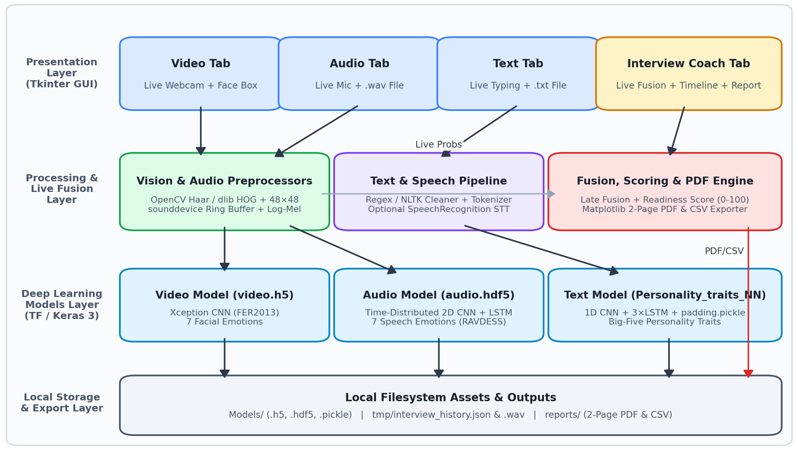
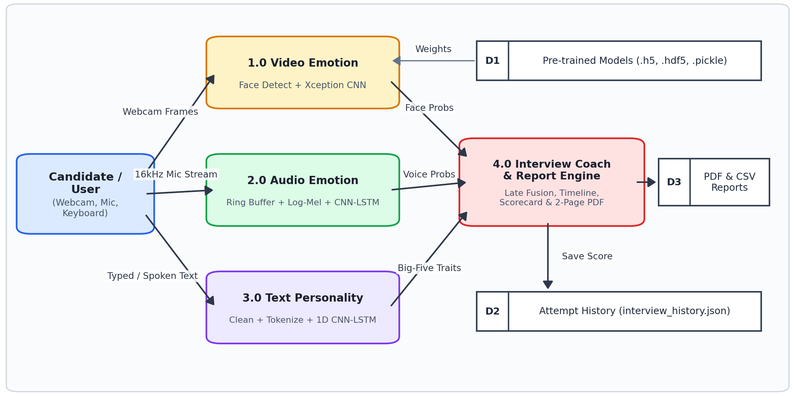
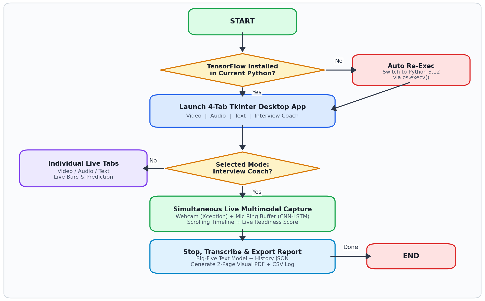
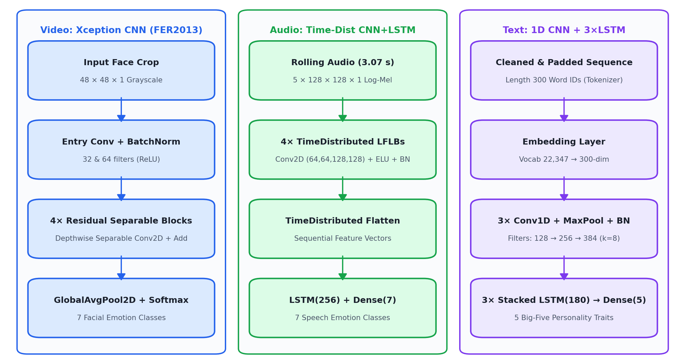
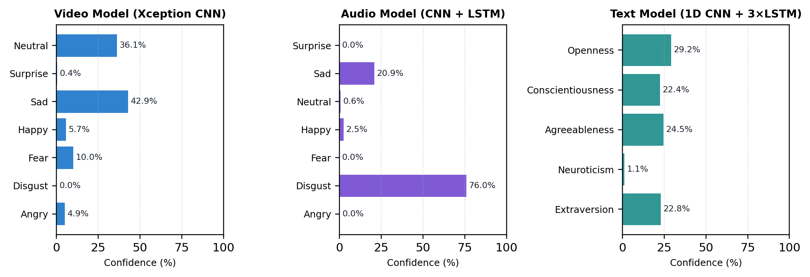
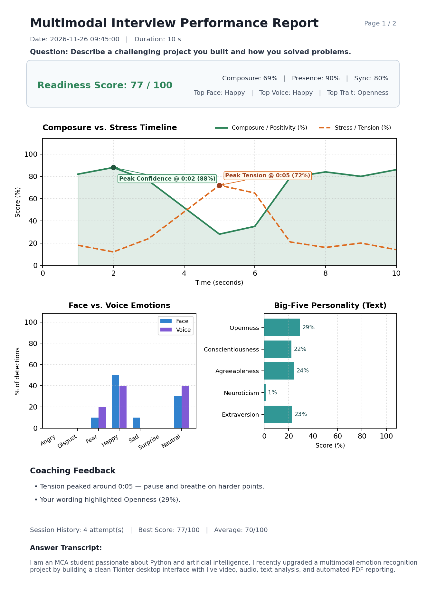
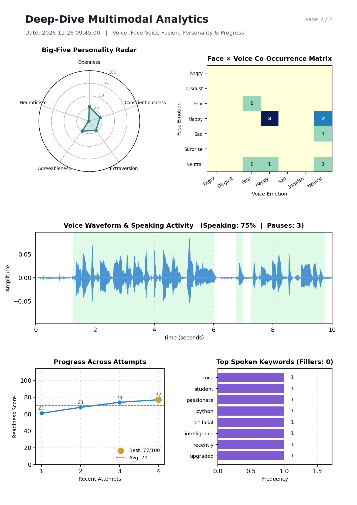

<div align="center">


# Real-Time Multimodal Emotion Recognition & AI Interview Coach

**A native Python & Tkinter desktop application combining real-time Facial, Vocal, and Textual AI analytics with multimodal late fusion and automated 2-page visual PDF reporting.**

[](https://www.python.org/)
[](https://www.tensorflow.org/)
[](https://opencv.org/)
[](https://docs.python.org/3/library/tkinter.html)
[](LICENSE)

[Features](#-application-tabs--features) •
[Architecture](#-system-architecture) •
[Deep Learning Models](#-deep-learning-models) •
[Results & PDF Report](#-results--visual-outputs) •
[Quick Start](#-quick-start) •
[Deliverables](#-project-report--presentation) •
[Team](#-team--guidance)

</div>

---

## Overview

Human communication expresses emotion and personality across multiple simultaneous channels — facial expressions, vocal tone, and choice of words. Evaluating only one signal in isolation misses subtle cues (such as smiling while sounding anxious during a job interview).

This project delivers a lightweight, **zero-web-server desktop application** built with **Tkinter** and **TensorFlow/Keras 3** that runs **three pre-trained deep learning models in real time** and unites them inside an all-in-one **AI Interview Coach** capable of live timeline plotting, Face–Voice alignment detection, Readiness Scoring, attempt tracking, and one-click **2-page PDF + CSV report export**.

---

## Application Tabs & Features

| Tab | Modality | Live Capability | Key Outputs |
| :--- | :--- | :--- | :--- |
| **1. Video** | Webcam (Visual) | Live face detection + Xception CNN inference on every 5th frame | Bounding box + live emotion/confidence overlay, session emotion bars, dominant emotion |
| **2. Audio** | Microphone / `.wav` (Acoustic) | Continuous 16 kHz `sounddevice` rolling 3-second ring buffer updated every `0.8 s` | Live mic level meter, 7-emotion real-time bars, `.wav` file analysis |
| **3. Text** | Keyboard / `.txt` (Linguistic) | Debounced live analysis (`450 ms`) as you type, paste, or load a file | Big-Five personality trait bars, dominant trait, word count & top keywords |
| **4. Interview Coach** | **Video + Audio + Text (Multimodal Fusion)** | Simultaneous webcam + mic tracking with preset/custom questions & countdown timer | Live Face–Voice Sync check, scrolling Composure vs. Stress timeline, Readiness Score (`0–100`), coaching tips, attempt history & **2-page PDF + CSV export** |

### Multimodal Readiness Score Formula
Inside the **Interview Coach** tab, live facial and vocal probabilities are fused every second:

```text
Composure        = Happy + Neutral + 0.5 × Surprise
Stress           = Fear + Angry + Sad + Disgust
Readiness Score  = round(0.50 × Composure + 0.25 × Camera Presence + 0.25 × Face–Voice Sync)
```

---

## System Architecture

<div align="center">
  
</div>

<details>
<summary><b>View Level 1 Data Flow Diagram (DFD) & End-to-End Workflow Flowchart</b></summary>
<br />
<div align="center">
  
  <br /><br />
  
</div>
</details>

---

## Deep Learning Models

All three models are lazily loaded once per session and cached in memory across all four tabs.

<div align="center">
  
</div>

| Modality | Weight File (`04-WebApp/Models/`) | Architecture | Input Tensor | Output Classes | Training Dataset |
| :--- | :--- | :--- | :--- | :--- | :--- |
| **Video (Face)** | `video.h5` | **Xception CNN** (Depthwise Separable Conv2D + Residual Add + GlobalAvgPool2D) | `(1, 48, 48, 1)` grayscale crop | 7 Emotions (`Angry`, `Disgust`, `Fear`, `Happy`, `Sad`, `Surprise`, `Neutral`) | **FER2013** |
| **Audio (Voice)** | `audio.hdf5` | **Time-Distributed 2D CNN** (4 LFLBs: 64→64→128→128 + ELU + BN) + **LSTM (256)** | `(N, 5, 128, 128, 1)` log-mel windows | 7 Emotions (`Angry`, `Disgust`, `Fear`, `Happy`, `Neutral`, `Sad`, `Surprise`) | **RAVDESS** |
| **Text (Traits)** | `Personality_traits_NN.h5` + `padding.pickle` | **Embedding (22347→300)** + **3×Conv1D** (128→256→384, k=8) + **3×LSTM (180)** | `(1, 300)` padded word IDs | **Big-Five Traits** (`Extraversion`, `Neuroticism`, `Agreeableness`, `Conscientiousness`, `Openness`) | **Pennebaker & King Essays** |

---

## Key Engineering Highlights

- **Zero Flask / Zero PyAudio:** Replaced the legacy Flask + HTML/D3.js stack and brittle PyAudio/PortAudio C-builds with native **Tkinter** and pre-built **`sounddevice`** wheels.
- **TensorFlow 2.20 / Keras 3 Compatibility:** Rebuilt legacy Keras 2 `video.h5` layer-by-layer from HDF5 metadata (verified **77/77 weight layers matched** with 0 mismatches), added `old_hard_sigmoid` for Keras 2 text LSTMs, and wrote a custom `pickle.Unpickler` for `padding.pickle` (no `keras_preprocessing` required).
- **Dual Face Detector (OpenCV 4 & 5 Safe):** Uses tuned OpenCV Haar Cascade (`scaleFactor=1.2, minNeighbors=4, minSize=(36, 36)`) with automatic fallback to **`dlib` HOG** on OpenCV 5.
- **Offline-Ready Text Pipeline:** Uses NLTK lemmatization when available and falls back seamlessly to built-in regex tokenization and stopwords when offline or without NLTK.
- **Smooth macOS Experience:** Automatically relaunches with Python 3.12 if invoked from a Python lacking TensorFlow, blocks the macOS `pyarrow` abort on TensorFlow import, and activates the Tk window to foreground via AppKit (`NSRunningApplication`).

---

## Results & Visual Outputs

### Real-Time 3-Model Inference Verification
<div align="center">
  
</div>

### Automated 2-Page PDF Performance Report (8 Visualizations + Raw CSV)
Clicking **Save Report (PDF + CSV)** in the **Interview Coach** tab exports a publication-ready A4 PDF alongside a second-by-second `_timeline.csv` log:

<table>
  <tr>
    <th width="50%">Page 1 — Executive Scorecard & Annotated Timeline</th>
    <th width="50%">Page 2 — Deep-Dive Multimodal Analytics</th>
  </tr>
  <tr>
    <td align="center"></td>
    <td align="center"></td>
  </tr>
  <tr>
    <td>
      • Readiness Score KPI Card (0–100) + Composure, Presence & Sync<br />
      • Composure vs. Stress Timeline with automatic <b>Peak Confidence</b> & <b>Peak Tension</b> pins<br />
      • Face vs. Voice Emotion Breakdown & Big-Five Summary<br />
      • Coaching Feedback, Session History & Answer Transcript
    </td>
    <td>
      • <b>Big-Five Personality Radar</b> (Spider) Chart<br />
      • <b>Face × Voice Co-Occurrence Matrix</b> (Multimodal Heatmap)<br />
      • <b>Voice Waveform & Speaking Activity</b> (Speaking % & Pauses)<br />
      • <b>Progress Across Attempts</b> & <b>Top Spoken Keywords</b> (with Fillers)
    </td>
  </tr>
</table>

---

## Quick Start

### 1. Clone the Repository
```bash
git clone https://github.com/Dev9055/Multimodal-Emotion-Recognition-Interview-Coach.git
cd Multimodal-Emotion-Recognition-Interview-Coach
```

### 2. Install Dependencies (Python 3.10 – 3.12 Recommended)
```bash
pip install -r requirements.txt
```
*(Optional — enable automatic Speech-to-Text transcription inside the Interview Coach tab:)*
```bash
pip install SpeechRecognition
```

### 3. Launch the Desktop App
```bash
python3 04-WebApp/main.py
# or directly:
python3 04-WebApp/app.py
```

> **macOS Permissions:** On first run, allow **Camera** and **Microphone** access for your Terminal or IDE under *System Settings → Privacy & Security*.

### 4. Regenerate Architecture & Output Figures (Optional)
```bash
python3 figures/generate_figures.py
```

---

## Project Report & Presentation

- **Final Project Report (26 Pages, UPES Format):** [Multimodal_Emotion_Recognition_Project_Report.pdf](Multimodal_Emotion_Recognition_Project_Report.pdf)
- **Presentation Deck (10 Slides, 16:9 Widescreen):** [Multimodal_Emotion_Recognition_Presentation.pptx](Multimodal_Emotion_Recognition_Presentation.pptx)

---

## Project Structure

```text
Multimodal-Emotion-Recognition-Interview-Coach/
├── 04-WebApp/
│   ├── main.py                  # Auto-switching Python 3.12 desktop launcher
│   ├── app.py                   # 4-tab Tkinter GUI & live Video / Audio / Text pipelines
│   ├── interview_coach.py       # Interview Coach late fusion, timeline & 2-page PDF/CSV exporter
│   ├── requirements_tkinter.txt # Desktop application requirements
│   ├── Models/                  # Pre-trained weights (video.h5, audio.hdf5, Personality_traits_NN.h5, padding.pickle)
│   ├── tmp/                     # Sample audio/image & runtime attempt history JSON
│   └── reports/                 # Default output folder for exported PDF reports & CSV timelines
├── figures/
│   ├── generate_figures.py      # Standalone script to regenerate all report/README diagrams
│   └── *.png                    # Architecture, DFD, Models, Flowchart, Outputs & UPES logo
├── 01-Audio/                    # RAVDESS audio preprocessing & CNN-LSTM notebooks (.ipynb)
├── 02-Text/                     # NLP Big-Five personality training notebooks (.ipynb)
├── 03-Video/                    # FER2013 facial expression Xception notebooks (.ipynb)
├── 00-Presentation/             # Reference presentation visual assets
├── Multimodal_Emotion_Recognition_Project_Report.pdf
├── Multimodal_Emotion_Recognition_Presentation.pptx
├── requirements.txt
├── .gitignore
└── LICENSE
```

---

## Team & Guidance

| Role | Name | Details |
| :--- | :--- | :--- |
| **Team Member 1** | **Devashish Singh** | SAP ID: `590038529` — MCA (Semester I) |
| **Team Member 2** | **Dhruv Dhiman** | SAP ID: `590040171` — MCA (Semester I) |
| **Faculty Guide** | **Dr. Tanu Singh** | School of Computer Science, UPES, Dehradun |
| **Academic Session** | **2026 – 2028** | Course: Python Programming — UPES, Dehradun |

---

## Credits & License

- Pre-trained base model weights in `04-WebApp/Models/` and training notebooks (`01-Audio`, `02-Text`, `03-Video`) originate from open-source work trained on **FER2013**, **RAVDESS**, and **Pennebaker & King Essays**, licensed under the **Apache License 2.0** (see [LICENSE](LICENSE)).
- The 4-tab Tkinter desktop architecture, Keras 3 model reconstruction, live rolling-buffer speech analysis, live debounced text analysis, AI Interview Coach fusion engine, and 2-page PDF/CSV reporting pipeline were built as our UPES MCA Final Project.
